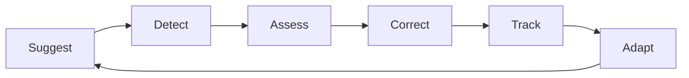
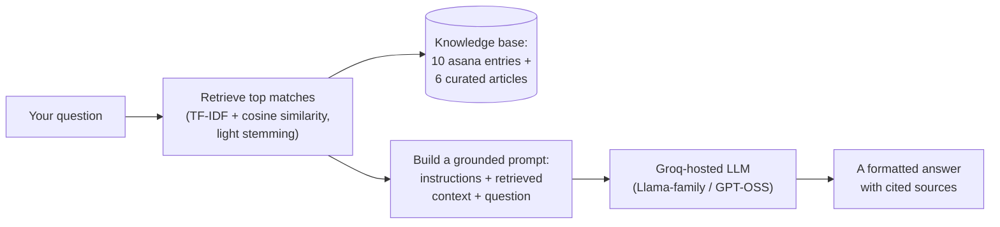
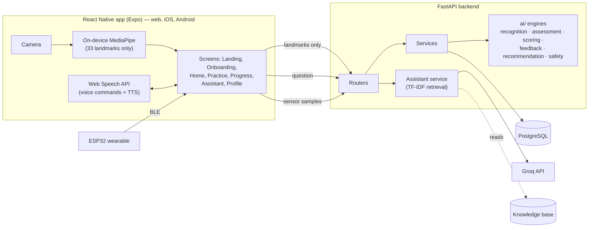

# AyuDrishti

*Sanskrit: **āyu** (life, vitality) + **dṛṣṭi** (sight, vision) — "the vision that watches over your practice."*

AyuDrishti is an AI yoga companion that does the one thing a video or a
picture-book of poses cannot: it **watches you practise and tells you, in
plain language, what to change** — then remembers what it saw and adapts what
it asks of you next time. It is a closed loop, not a library of clips.

This document is the whole story of the system: the problem it was built for,
the idea at its centre, how each piece actually works and why it was built
that way, and an honest account of what is real versus what is estimated.
Setup, API, and deployment instructions are at the end.

---

## Contents

- [The problem](#the-problem)
- [The idea: a closed loop](#the-idea-a-closed-loop)
- [How assessment actually works](#how-assessment-actually-works)
- [How the plan is chosen — and how it adapts](#how-the-plan-is-chosen--and-how-it-adapts)
- [The yoga assistant: retrieval, not a chatbot](#the-yoga-assistant-retrieval-not-a-chatbot)
- [Practising hands-free: voice and speech](#practising-hands-free-voice-and-speech)
- [The optional wearable](#the-optional-wearable)
- [Honesty by construction](#honesty-by-construction)
- [How the system is put together](#how-the-system-is-put-together)
- [The technology, and why](#the-technology-and-why)
- [Running it yourself](#running-it-yourself)
- [The API](#the-api)
- [Deploying it](#deploying-it)
- [Testing](#testing)
- [Where it stops (for now)](#where-it-stops-for-now)

---

## The problem

Picture a beginner who wants to start yoga at home. They open an app and get
a playlist of poses — a video of someone flawless, a name, maybe a sentence
of instruction. And then they are alone. Are their hips square? Is that front
knee collapsing inward in a way that will hurt tomorrow? Are they actually
improving, week over week, or just repeating the same three mistakes with
great consistency? The app cannot say. It never looked.

This is the gap. It is not a shortage of *content* — the internet is drowning
in yoga content. It is the absence of a **feedback loop**. A good teacher does
not just show you the pose; they watch your pose, name the specific thing that
is off, tell you how to fix it, and remember it for next week. Everything
downstream of "watch and respond" is what makes a teacher a teacher, and it is
exactly what a pre-recorded video can never do.

AyuDrishti was built to close that gap with a camera and a phone — no
instructor in the room, no expensive hardware, and no video of you ever
leaving your device.

---

## The idea: a closed loop

The temptation, when you say "AI yoga app," is to build a pose *classifier* —
a model that looks at a frame and announces "this is Warrior II." That is a
solved and, frankly, shallow problem. Knowing the *name* of a pose helps
nobody who is trying to do it well.

The distinction AyuDrishti is built around is this:

> **Recognition** asks *"which pose is this?"*
> **Assessment** asks *"how well is it being done, and what specifically should change?"*

A classifier says *"Warrior II."* AyuDrishti says:

> **Warrior II — 84%.** Your front knee has drifted past your ankle. Draw it
> back so the shin stacks vertically over the heel.
> *(front_knee_over_ankle measured 0.62 torso-lengths; target 0.00–0.30)*

That second sentence — the *why* behind the number, traceable to a measured
joint distance — is the entire point. And it only becomes valuable when it is
wired into a cycle:



**Suggest** a session fitted to your goals. **Detect** your body from the
camera. **Assess** the pose against its own rules. **Correct** you with
specific, spoken guidance. **Track** what you actually achieved. **Adapt** the
next session from what was measured — a pose you keep struggling with comes
back around, deliberately. Then suggest again.

Every screen, service, and test in this repository exists to serve one leg of
that loop. The innovation is the loop; computer vision is just how one leg of
it sees.

---

## How assessment actually works

Assessment is the heart of the system, so it is worth understanding how it
reaches a number — because the design choices here are what separate it from a
black box that emits a score you cannot argue with.

### Rules per pose, not one universal threshold

Ninety degrees of knee flexion is *correct* in Warrior II and *wrong* in
Mountain Pose. There is no single "correct knee angle." So every asana owns its
own rules, target ranges, tolerances, and — crucially — its own corrective
sentences, in a plain JSON file:

```json
{
  "id": "front_knee_over_ankle",
  "component": "knee",
  "body_part": "front knee",
  "measurement": "horizontal_gap",
  "landmarks": ["lead_knee", "lead_ankle"],
  "target": [0.0, 0.3],
  "tolerance": 0.45,
  "weight": 2.5,
  "feedback": {
    "high": "Your front knee has drifted away from your ankle. Move it back so it stacks directly over the ankle."
  }
}
```

There are eleven measurement primitives — joint angles, segment orientation,
straightness, normalised gaps, distance ratios, point-to-line distance, and
more. Every distance is expressed in **torso-lengths**, not pixels, so standing
closer to or further from the camera does not change your score. The pose
library is data, not code: a new asana is a new JSON file, picked up on
restart, no retraining and no Python change. A malformed rule file fails loudly
at startup rather than silently mid-session.

### A gradient, not a verdict

Inside its target range a rule scores a full 1.0. Outside, the score falls off
*linearly* with distance from the nearest edge of the range, reaching zero one
full `tolerance` beyond it. A knee five degrees off does not look like a knee
forty degrees off — because it shouldn't. And rules are **weighted**: a
collapsing front knee (a genuine injury risk) outranks a slightly low rear arm,
so the feedback you hear first is the feedback that matters most.

### It refuses to guess

If the camera cannot confidently see a landmark — a hip hidden behind a
forearm, say — every rule that depends on it is marked **unavailable** and
dropped from the score entirely. The system does not invent a measurement to
fill the gap. Instead it lowers its reported **confidence** and tells you which
joints are hidden and where to move the camera. A score you can trust is worth
more than a score that is always there.

### Left lead or right lead

Warrior II, Triangle, and Tree can each be led with either leg. The rules are
written with `lead_`/`rear_` placeholders; the engine evaluates *both*
possible assignments and keeps whichever fits better — so a clean right-lead
Warrior II is never mistakenly graded as a botched left-lead one.

### Why recognition and assessment share rules but not sharpness

Here is a subtle trap: if you use your strict assessment rules to *recognise*
the pose, then a beginner's wobbly Warrior II — the exact person who needs
help most — fails to be recognised as Warrior II at all, and gets no feedback.
So recognition reuses the same rules but with **widened tolerances**: it
matches the *shape* of the pose, not its *quality*.

With one deliberate exception. A handful of rules are marked
`discriminative` and stay sharp even during recognition — "hips above
shoulders" is precisely what separates Downward Dog from a seated forward fold,
and widening it would erase the very distinction it exists to draw.

---

## How the plan is chosen — and how it adapts

The recommendation engine is, by deliberate choice, a **transparent rule-based
scorer** rather than a black box. Each candidate asana's score is a sum of
named, signed contributions, and each contribution carries the sentence that
explains it:

```
Warrior II  score 20.4
  +6.0  Supports your strength goal.
  +4.0  Works the legs you asked to focus on.
  +5.6  Chosen to work on your knee alignment, your weakest area.
  +3.5  You are averaging 69% here, so it is worth revisiting.
  +3.0  Matched to your intermediate level.
```

The app shows this breakdown on the Recommendations screen, because a
practitioner who understands *why* a pose was chosen is far more likely to
actually do it. Two design decisions keep the plans safe and sensible:

- **Difficulty is a hard gate, not a soft penalty.** A pose more than one level
  above you is never offered at all; a pose one level up appears only once your
  recent scores show you are ready. Pure scoring would eventually surface an
  over-hard pose whenever the easy library ran thin — the gate prevents that.

- **Sessions are sequenced, not merely ranked.** Warm-up → standing → balance →
  floor → cool-down. Unilateral poses are practised on both sides. When your
  suitable library is small — a beginner has five appropriate poses — the core
  sequence repeats in gentle rounds rather than padding a single hold to an
  unsafe length or quietly handing back a shorter session than you asked for.

### Adaptation is what closes the loop

After each session, a `PerformanceAnalyzer` reads the recorded assessments and
derives your recurring component weaknesses, your per-asana trajectory
(struggling, plateaued, or mastered), and your practice consistency. These
become *scoring factors* — which means last session's measured weakness
changes this session's plan through **the same code path as everything else**.
There is no separate "adaptation" branch bolted on; the loop closes through the
ordinary scorer. A pose you struggle with is repeated *on purpose*, not
quietly dropped because you scored badly on it.

---

## The yoga assistant: retrieval, not a chatbot

Alongside the practice loop lives a conversational assistant — but it is
deliberately **not** a general chatbot bolted onto a yoga app. It is
retrieval-augmented: every answer is grounded in AyuDrishti's *own* knowledge,
so it explains the same poses the assessment engine grades, and can cite real
research rather than confidently inventing it.



The corpus is small and honest about it: the ten asanas' descriptions, cues,
benefits, and contraindications, plus six curated articles (yoga's history and
philosophy, pranayama, meditation, safe practice, getting started, and a
references list of real papers and standards). For a few dozen documents,
TF-IDF with cosine similarity is exactly the right-sized tool — a vector
database would be solving a scale problem this corpus does not have, and
saying so plainly is more honest than pretending otherwise.

Retrieval earned its keep through a couple of real fixes. Stripping the words
"yoga" and "pose" as too-common once left a question like *"what is yoga?"*
with nothing to search on at all; that is gone. And a light stemmer now unifies
word forms — *"how to breathe"* finds the **breath-control** article,
*"how to meditate"* finds the **meditation** one — because a searcher should
not have to guess the exact word an author used.

The retrieved passages are the *only* context the language model is given, with
an explicit instruction to answer from them, to defer injury, pregnancy, and
medical questions to a qualified professional, and — importantly — to **never
invent a link**. Real references come from the curated list; nothing else is
fabricated. Every answer returns the titles of the passages it stood on, shown
beneath it in the chat, so any claim can be traced back to what the app
actually knows.

Generation runs on a Groq-hosted open model via an OpenAI-compatible endpoint;
the model is a single environment variable, because model line-ups change and
a good design does not hard-code a moving target. Without a key configured, the
assistant reports itself unavailable cleanly rather than failing in a confusing
way — everything else in the app works regardless.

---

## Practising hands-free: voice and speech

Yoga is a poor fit for a touchscreen — your hands are on the mat, not the
phone. So a full session can be driven by **voice**, using the browser's own
speech APIs with no external service and no added dependency:

- Say **"ready"** and the app begins checking the pose you are holding.
- It **speaks the correction aloud** — *"lower your shoulders, lengthen your
  spine"* — so you never look at the screen.
- Say **"retry"** to attempt the same pose again, or **"next"** to move on. The
  loop continues, spoken and hands-free, until you are done.

Every voice command has an always-present on-screen button as a fallback, and
the whole feature degrades gracefully where the Web Speech API is absent — the
app never depends on it. The interface also speaks two languages, **English and
Hindi**, and a free-text box on the profile lets you describe your practice in
your own words (*"I'm a beginner, 20 minutes, knee pain sometimes"*) and have
your preferences detected — always shown for your confirmation before anything
is saved, and parsed deterministically rather than guessed at by a model.

---

## The optional wearable

For those who want it, a small ESP32-based wearable adds a second, physiological
channel — but it is genuinely **optional**, and nothing in the core loop fails
without it.

```
MAX30102 (HR, SpO₂) + GSR + MPU6050 (motion) + OLED → ESP32 → BLE → app → sensor fusion
```

The full path is implemented in code. The [ESP32
firmware](wearable/esp32/ayudrishti_wearable.ino) reads the three sensors,
shows the live values on an on-board SSD1306 OLED, and streams a JSON telemetry
packet over BLE about once a second. Two receivers consume it: the app connects
directly via **Web Bluetooth** ([`useWearable.js`](frontend/src/wearable/useWearable.js))
— a "Connect band" button on the Profile screen pairs with the band, shows live
HR/SpO₂/GSR/motion, and forwards the readings to the backend — and a
[standalone Python receiver](wearable/sensor_processing/ble_receiver.py) does the
same job from a laptop for hardware bring-up. From there the backend takes over.

Readings are median-smoothed and expressed against *your own* session baseline,
because absolute heart rate and skin conductance vary enormously between people.
The safety layer only speaks up when **posture strain and physiological strain
appear together** — poor alignment alone might just be a beginner learning, and
a raised heart rate alone is normal in a vigorous pose. Only their coincidence
suggests it is time to rest.

This is a wellness accessory built from hobbyist sensors. It is **not a medical
device** and performs no diagnosis; every message derived from sensor data
carries that disclaimer in its own text, so a UI that renders only the message
cannot accidentally drop the caveat.

---

## Honesty by construction

A recurring principle runs through the codebase: be honest in the *structure*,
not just in a disclaimer footnote.

- **Privacy is structural.** Pose detection runs on your device; only 33
  landmark coordinates ever reach the server — no image, frame, or video
  leaves the device, ever. The database stores derived metrics only (scores,
  component breakdowns, corrections); `STORE_RAW_FRAMES` and `RETAIN_LANDMARKS`
  both default to false. Session lookups return an identical 404 for "missing"
  and "belongs to someone else," so the API cannot be used to probe for other
  users' data, and login gives the same error for an unknown email and a wrong
  password, so it cannot be used to enumerate accounts.

- **The thresholds are informed estimates, and the code says so.** Target
  ranges come from standard teaching cues and biomechanics literature, not a
  validated clinical trial. They are a good coach's judgement expressed
  numerically — useful, and explicitly not a substitute for a qualified
  teacher, especially with an injury.

- **The safety layer never diagnoses.** The strongest action the system ever
  takes is suggesting you pause and rest. A test in the suite actively forbids
  any safety alert from claiming a diagnosis, and another forbids any pose rule
  from telling you that you are simply "wrong."

---

## How the system is put together

The codebase is organised so that the *intelligence* is completely independent
of the web framework and the database. The `ai/` package imports no FastAPI and
no ORM; the assessment engine can be driven from a script, a notebook, or a
test with no server running at all. The backend consumes `ai/` — never the
reverse.



Laid out on disk:

```
ayudrishti/
├── ai/                      Framework-independent intelligence
│   ├── pose_detection/      MediaPipe adapters, landmark model, OpenCV video
│   ├── pose_recognition/    Features, rule-based recogniser, optional ML
│   ├── pose_assessment/     Geometry, rule engine, per-asana configs
│   ├── scoring/             Rule results → component and session scores
│   ├── feedback/            Prioritised, throttled corrective coaching
│   ├── recommendation/      Transparent scorer + performance analysis
│   └── safety/              Motion, sustained-deviation and sensor fusion
├── backend/                 FastAPI (auth, users, asanas, recommendations,
│   │                        sessions, assessment, progress, wearables, assistant)
│   └── services/            Business logic + ORM↔AI translation
│                            (assistant_service.py holds the RAG pipeline)
├── frontend/                React Native (Expo)
│   └── src/
│       ├── screens/         Landing, Onboarding, Home, Practice, Progress,
│       │                    Assistant, Profile
│       ├── voice/           Web Speech API wrappers (commands + text-to-speech)
│       └── nlp/             Deterministic free-text preference parser
├── data/
│   ├── pose_rules/          One JSON per asana — the source of truth
│   ├── knowledge/           Markdown the assistant retrieves from
│   └── models/              Downloaded pose-detection weights
├── wearable/
│   ├── esp32/               Arduino firmware
│   └── sensor_processing/   Parsing, smoothing, baselines
└── tests/                   92 tests, incl. a full loop through the REST API
```

### The asana library today

| Asana | English | Difficulty | Best view | Rules |
|---|---|---|---|---|
| Tadasana | Mountain Pose | beginner | front | 10 |
| Utkatasana | Chair Pose | beginner | side | 8 |
| Bhujangasana | Cobra Pose | beginner | side | 9 |
| Setu Bandhasana | Bridge Pose | beginner | side | 6 |
| Balasana | Child's Pose | beginner | side | 6 |
| Virabhadrasana II | Warrior II | intermediate | front | 11 |
| Trikonasana | Triangle Pose | intermediate | front | 10 |
| Vrikshasana | Tree Pose | intermediate | front | 7 |
| Adho Mukha Svanasana | Downward Dog | intermediate | side | 8 |
| Paschimottanasana | Seated Forward Bend | intermediate | side | 7 |

Ten asanas, **82 alignment rules** in total. Some poses can only be judged
fairly from one angle — knee flexion in Chair Pose vanishes when viewed
head-on — so each asana declares a `preferred_view` and the app tells you where
to place the camera.

---

## The technology, and why

| Layer | Choice | Why this one |
|---|---|---|
| App | React Native + Expo | One codebase for web, iOS, and Android; `npm run web` needs no device |
| On-device vision | MediaPipe Pose | Runs in the browser/device — no frame reaches the server |
| Voice | Web Speech API | Browser-native; no external speech service, no dependency |
| Backend | FastAPI + Uvicorn | Async, typed, auto-generates OpenAPI docs at `/docs` |
| Database | PostgreSQL + SQLAlchemy 2.0 | The real target; SQLite is a first-run fallback only |
| Auth | JWT + bcrypt | Stateless tokens; passwords SHA-256 pre-hashed then bcrypt-hashed |
| Assessment & recommendation | Hand-authored rule engines | Deliberately transparent, not a black box |
| Assistant retrieval | scikit-learn TF-IDF + cosine similarity | Right-sized for a few dozen documents |
| Assistant generation | Groq-hosted open model (GPT-OSS / Llama family) | Fast, free-tier friendly, swappable by env var |
| Wearable | ESP32 + BLE (MAX30102, GSR, MPU6050) | Optional physiological channel; app works without it |
| Charts | Recharts (web) / react-native-svg (native) | Recharts can't mount outside the DOM; native gets an SVG twin |

The `ai/` layer depends on numpy, scikit-learn, OpenCV, and MediaPipe; the
server adds FastAPI, SQLAlchemy, and the JWT/bcrypt stack. Ninety-two tests run
on `pytest`.

---

## Running it yourself

**Prerequisites:** Python 3.11+ (3.12 recommended), Node 18+, and — optionally
for a first run — PostgreSQL 14+.

**1. The backend.**

```bash
pip install -r requirements.txt
```

```bash
cp .env.example .env
```

Set `DATABASE_URL` to your PostgreSQL instance and generate a `SECRET_KEY` with
`python -c "import secrets; print(secrets.token_urlsafe(48))"`, then:

```bash
uvicorn backend.main:app --reload --port 8000
```

Tables are created and the asana library is seeded on startup; interactive API
docs live at `http://localhost:8000/docs`. If `DATABASE_URL` is unset the app
falls back to SQLite so a fresh checkout runs and the tests pass without a
server — it logs a warning whenever that fallback is active. Don't ship on it.

**2. See the whole loop without a camera.**

```bash
python scripts/demo_loop.py
```

Walks every stage in the terminal with clearly-labelled synthetic skeletons —
every score, correction, and recommendation shown is computed live by the real
engines.

**3. See it on a webcam.**

```bash
python scripts/fetch_models.py && python scripts/live_session.py
```

Camera → MediaPipe → joint angles → recognition → assessment → live
corrections, drawn over the video. No backend needed — the fastest way to
iterate on alignment rules, since a rule edit shows up on the next frame.

**4. The app.**

```bash
cd frontend && npm install && npm run web
```

> If Expo complains about an "unknown module," clear Metro's cache with
> `npm run web -- --clear` — it caches numeric module ids that shift whenever
> dependencies change, and this is the usual cause after an `npm install`.

To enable the assistant, add a free [Groq API key](https://console.groq.com/keys)
as `GROQ_API_KEY` in `.env` (and pick a current model with `GROQ_MODEL`).

---

## The API

Full interactive docs are always at `http://localhost:8000/docs`. Every route
except `/auth/*`, the read-only `/asanas`, `/assistant/status`, and `/health`
requires a bearer token from `/auth/login` or `/auth/register`.

| Area | Endpoints |
|---|---|
| Auth | `POST /auth/register` · `POST /auth/login` · `POST /auth/refresh` |
| Profile | `GET /users/me` · `PUT /users/me` |
| Asana library | `GET /asanas` · `GET /asanas/{id}` *(includes every rule)* |
| Recommendations | `GET /recommendations` · `POST /recommendations/generate` · `GET /recommendations/latest` |
| Sessions | `POST /sessions` · `GET /sessions` · `GET /sessions/{id}` · `POST /sessions/{id}/complete` |
| Assessment | `POST /assessment` · `POST /assessment/pose` · `POST /assessment/reset` |
| Progress | `GET /progress` · `GET /progress/{asana_id}` |
| Wearables *(optional)* | `POST /wearables/connect` · `POST /wearables/data` · `GET /wearables/status` |
| Assistant | `GET /assistant/status` · `POST /assistant/ask` |
| Health | `GET /health` |

The centrepiece, `POST /assessment`, takes exactly the 33 MediaPipe landmark
coordinates for one frame and returns the score, the per-component breakdown,
every rule's measurement, prioritised corrective feedback, the joints to
highlight, and any safety alerts. Omit the `asana_id` and it recognises the
pose first — so the same endpoint serves both a guided session and free
practice. A user can only ever read or complete their own sessions.

---

## Deploying it

This is two different kinds of app, so it wants two different hosts.

**Frontend → Vercel (or Netlify).** Both `frontend/` (the app, exported as
static web) and `landing/` (the standalone marketing page) are static builds —
camera and pose detection run entirely in the browser. Deploy each as its own
project with its subdirectory as the Root Directory, build command
`npm run build`, output `dist`. Set `EXPO_PUBLIC_API_BASE_URL` (for the app) to
your deployed backend's URL **before the first build** — it is inlined at build
time, so changing it later means redeploying, not restarting.

**Backend → Railway (or Render).** FastAPI + SQLAlchemy is a persistent server
with a database, which rules out serverless platforms. Point the service at the
repo root with a start command of
`uvicorn backend.main:app --host 0.0.0.0 --port $PORT` (a `Procfile` provides
this), attach a managed PostgreSQL and reference its `DATABASE_URL`, set a real
`SECRET_KEY`, set `CORS_ORIGINS` to your frontend's exact origin (no trailing
slash), and — for the assistant — `GROQ_API_KEY` plus a current `GROQ_MODEL`.
Tables and the asana library seed themselves on first boot; there is no manual
migration step for a first deploy. A `.python-version` pins Python 3.12, and
the server uses headless OpenCV so no system graphics libraries are needed.

---

## Testing

```bash
python -m pytest tests/ -q
```

Ninety-two tests. Beyond ordinary unit coverage, several encode product
*requirements* directly, so a regression in intent fails the build:

- Every rule in every asana must carry actionable feedback text — and none of
  it may tell the user they are "incorrect" or "wrong."
- The same joint must never share one universal threshold across poses.
- A poorly-performed pose must still be *recognised* correctly.
- A correction suppressed by cooldown must never be mistaken for a fixed fault.
- No safety alert may claim a diagnosis.
- One user cannot read another user's sessions.
- And the whole loop, through the real REST API: register → recommend → assess
  → correct → complete → progress → an **adapted** recommendation.

---

## Where it stops (for now)

An honest closing, because a README that only lists strengths is a sales page.

- **Native live detection needs one more piece.** MediaPipe has no JavaScript
  runtime inside React Native's engine, so live camera detection on iOS/Android
  requires a native frame processor in a custom dev build. The single
  integration seam is provided (`PoseDetector.nativeFrameProcessor`) and
  everything downstream already speaks that landmark format. Web and desktop
  are fully working today.

- **Single-camera 2D has limits.** Landmarks are 2D projections; rotation away
  from the camera and true depth are poorly observed, which is exactly why each
  asana declares a preferred view and why confidence is reported alongside
  every score rather than hidden.

- **The alignment thresholds are estimates, not clinical findings.**

- **The wearable is code-complete but not hardware-validated.** Firmware,
  the BLE bridge (in-app Web Bluetooth and a laptop receiver), and the backend
  fusion all exist and are wired end to end — but the loop has not yet been run
  on a physical board, so the sensor readings are unproven and the SpO₂ figure
  in particular is a simplified approximation, not a calibrated reading. Web
  Bluetooth also needs Chrome or Edge (desktop or Android); iOS Safari has no
  Web Bluetooth, so the band pairs there only via a future native build.

- **AyuDrishti is not a medical device.** It does not diagnose injuries or
  conditions. The strongest thing it will ever do is ask you to pause and rest.

What it *is*, today, is a working closed loop: it suggests a session for your
goals, watches you practise through the camera, tells you the specific thing to
fix and why, remembers what it measured, and comes back tomorrow with a plan
shaped by it — and it can talk with you about the practice along the way.
